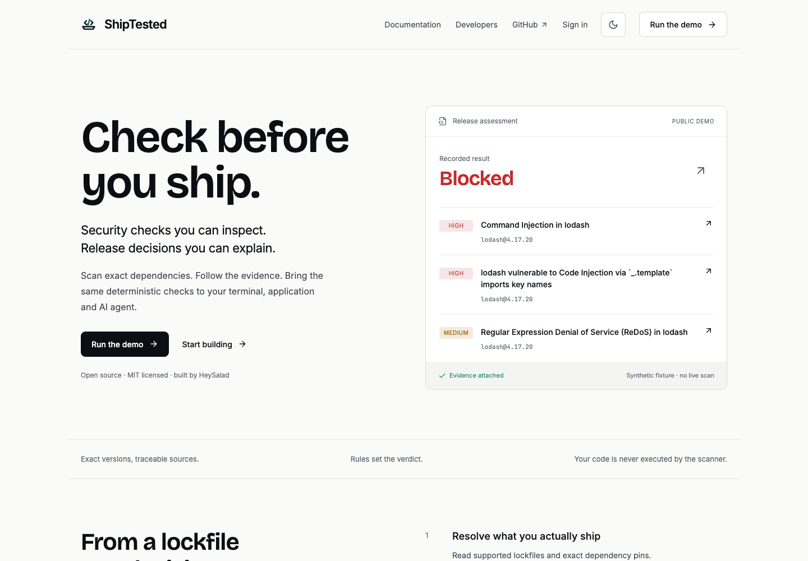
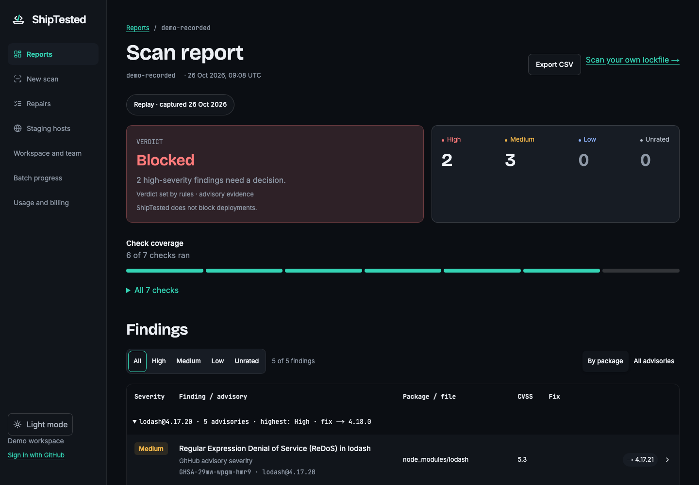
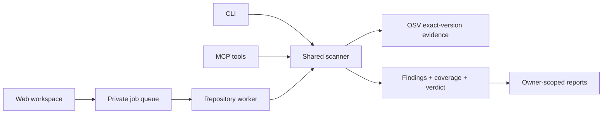

# ShipTested

**Security checks you can inspect. Release decisions you can explain.**

An open-source dependency scanner with a shared TypeScript core, CLI, MCP server and hosted report workspace. Exact versions go in; findings, source evidence and explicit coverage limits come out.

[Documentation](https://docs.shiptested.com/docs) · [Developer guide](https://shiptested.com/developers) · [Examples](examples) · [Contributing](CONTRIBUTING.md) · [MIT license](LICENSE)



## Start locally

Use **Node 22**. From this repository:

```sh
npm ci
npm run dev
```

Open **http://127.0.0.1:3147** and choose **Run the demo**. The demo uses public synthetic evidence; it does not scan a private repository. Member workflows need private configuration—see [hosted operations](docs/HOSTED-OPERATIONS.md).

To explore the core without credentials or network requests:

```sh
npm run build:packages
node examples/inspect-lockfile.mjs
```

To scan your own lockfile with live OSV queries:

```sh
node packages/cli/dist/index.js scan /path/to/package-lock.json --json
```

No dependency installation or repository code execution occurs during the scan. OSV receives package names and versions. Never install the deliberately vulnerable dependencies in a demo fixture.

## Choose your interface

| Interface | What it does | Reference |
| --- | --- | --- |
| TypeScript library | Exact-version parsing, advisory matching, findings and policy | [Core](packages/core) |
| CLI | Terminal stages, JSON, SARIF and explicit CI exit codes | [CLI](packages/cli) |
| MCP | Structured tools for local and remote agent workflows | [MCP](packages/mcp) |
| Web workspace | Evidence reports, review, repository jobs and batch progress | [Hosted workflow](docs/HOSTED-WORKFLOW.md) |
| Repair workflow | Bounded npm patch verification and human-approved draft PRs | [Implementation status](docs/IMPLEMENTATION-STATUS.md) |

```ts
import { readFile } from 'node:fs/promises';
import { scan } from '@heysalad/shiptested';

const report = await scan({
  filename: 'package-lock.json',
  lockfile: await readFile('package-lock.json', 'utf8'),
});

console.log(report.status);
console.log(report.findings);
```

Published packages are version **0.1.0**. This development branch includes newer hosted and scanner improvements; building from source is the way to evaluate them. A protected Preview is not a production release.

## Evidence, then a decision



Every report carries the checked versions, advisory references, retrieval dates and coverage state. Verified findings survive partial advisory lookup failures. Optional research and model explanations support triage; they do not set severity or remove findings.

| Verdict | Meaning |
| --- | --- |
| **Blocked** | A high-severity finding needs attention. Other coverage can still be incomplete. |
| **Incomplete** | Some required checks could not establish coverage. |
| **Review required** | Findings remain for a person to assess. |
| **Checks passed** | No findings within the completed, documented checks. |

CLI exit codes are `0` passed, `1` blocked/threshold met, `2` review, `3` incomplete, `64` input error and `70` internal/output error. Incomplete coverage takes precedence in CLI exit handling.

**A dependency match is not proof of exploitability.** Supported inputs are npm lockfiles v2/v3, exact npm manifest versions and a conservative subset of exact Python pins. Unresolved versions, unsupported formats and bounded discovery gaps stay explicit. General source-code analysis, Git history and application business logic are not established by these scans. Candidate fixed versions require a rescan and application tests.

## Architecture



Repository access uses a server-bound GitHub App installation. Jobs pin source commits and use stable request keys, allowance reservations and worker leases. Hosted data is scoped to workspace and owner. Batch progress includes waiting, queued, running, terminal and explicitly skipped entries. [Read the hosted workflow](docs/HOSTED-WORKFLOW.md).

## Develop and contribute

```sh
npm run typecheck
npm test
npm run build
npx playwright install chromium
npm run test:e2e
```

The app binds to loopback. Browser tests use a separate server on port 3148. See [CONTRIBUTING.md](CONTRIBUTING.md) for workspace structure, examples and change verification.

- [Developer quickstart](apps/docs/content/docs/quickstart.mdx)
- [Runnable examples and CI template](examples)
- [Self-hosting](apps/docs/content/docs/self-hosting.mdx)
- [Security and privacy boundaries](docs/HOSTED-OPERATIONS.md)
- [Implementation status and release evidence](docs/IMPLEMENTATION-STATUS.md)
- [Screenshot gallery and reproduction](docs/screenshots/README.md)

## Open source, explicit boundaries

MIT applies to original ShipTested code. Dependencies, fonts and advisory data retain their upstream terms. Advisory matching uses [OSV](https://osv.dev/); optional research uses Tavily, and optional Nemotron explanations run through Nebius. These integrations do not imply vendor endorsement.

Do not commit `.env` files, credentials, private repository snapshots or customer reports. Keep security reports out of public issues when they contain secrets or exploit-sensitive details. See the application's [security page](https://shiptested.com/security) for its disclosure guidance.

Built by **HeySalad** for teams that want to understand what they ship.
