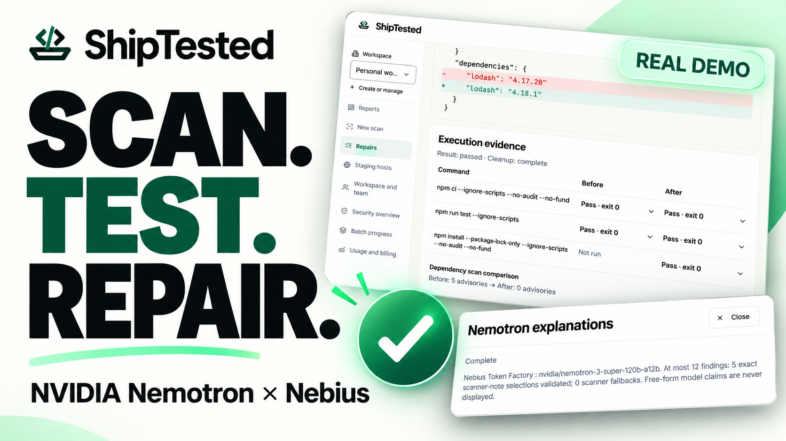
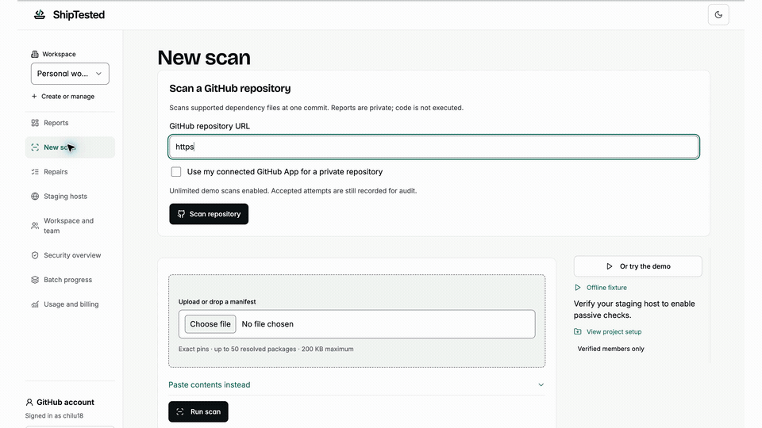
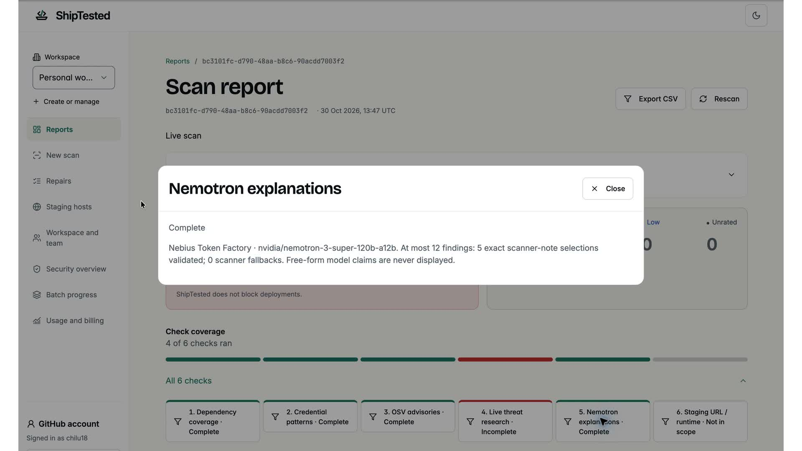
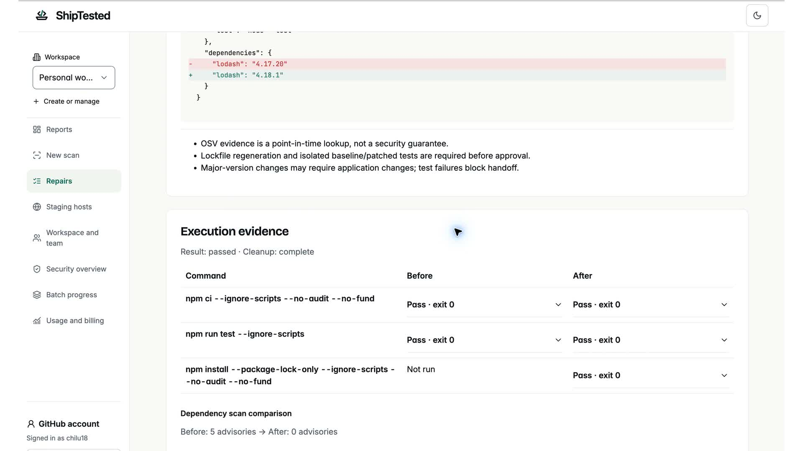
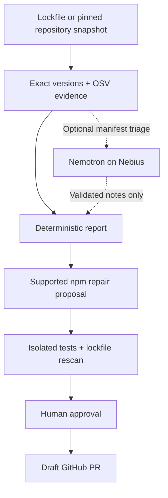

<p align="center">
  <picture>
    <source media="(prefers-color-scheme: dark)" srcset="public/brand/shiptested-lockup-dark-bg.svg">
    
  </picture>
</p>

<h1 align="center">Check before you ship.</h1>

<p align="center">
  Dependency evidence. Isolated tests. A repair you approve.<br>
  Built with NVIDIA Nemotron on Nebius Token Factory.
</p>

<p align="center">
  <a href="https://shiptested.com">Open ShipTested</a> ·
  <a href="https://youtu.be/JDITvuA2lD8">Watch the demo</a> ·
  <a href="#run-it-locally">Quickstart</a> ·
  <a href="docs/RECORDED-DEMO.md">Judge walkthrough</a>
</p>

[](https://youtu.be/JDITvuA2lD8)

<p align="center"><strong><a href="https://youtu.be/JDITvuA2lD8">▶ Watch the full narrated demo · 2 minutes 45 seconds</a></strong><br>
Real screen recordings · GitHub repository → scan → evidence → verified repair → draft PR</p>

ShipTested helps small teams move from a dependency warning to a reviewed fix. It matches exact package versions against OSV advisories, keeps the source behind each finding, and tests supported npm repairs in isolated sandboxes before a person approves a draft pull request.

**The demo result:** `lodash 4.17.20 → 4.18.1` · **5 → 0 dependency advisories** · **tests passed before and after** · [**draft PR created**](https://github.com/chilu18/shiptested-fresh-judge-demo/pull/1).

> Recorded on 30 October 2026 against the hosted application. The video includes a separate manifest scan for Nemotron triage. This repository's local demo replays a fixture; hosted UI and configuration can differ from this checkout. See the [walkthrough and evidence](docs/RECORDED-DEMO.md). Zero advisories is a result within the scanned dependency scope, not a whole-application security guarantee.

## From a warning to a reviewed repair



*15-second preview, edited from the actual recording and played at 2× speed. Prefer a still image? [Open the scan report](docs/media/scan-report.jpg).*

| Step | What you get |
| --- | --- |
| **Scan** | Exact-version advisory matching, supported credential-pattern checks, and explicit coverage gaps. The hosted repository scan records the source commit. |
| **Understand** | Source-linked findings and optional Nemotron-assisted notes. Deterministic rules retain control of severity and the verdict. |
| **Verify** | For supported direct npm upgrades: the proposed patch, baseline and patched test outcomes, a regenerated lockfile, and a fresh dependency scan. |
| **Approve** | Review the exact change and its evidence, then approve a draft PR. No automatic merge or deployment. |

## NVIDIA Nemotron, with evidence boundaries

The recorded manifest scan calls **`nvidia/nemotron-3-super-120b-a12b`** through **Nebius Token Factory**. Nemotron selects from scanner-authored notes; output validation rejects invented wording and retains scanner fallbacks. It cannot remove findings, alter severity, or change the verdict. Repair planning is deterministic and separate from this AI step.



*The recorded run validated five note selections with zero fallbacks. Optional Tavily research was not configured in this recording; its incomplete coverage remains visible.*

## A fix comes with its test results



The demo uses a [public synthetic repository](https://github.com/chilu18/shiptested-fresh-judge-demo). You can inspect the [resulting draft PR and diff](https://github.com/chilu18/shiptested-fresh-judge-demo/pull/1/files) without a ShipTested account. Only `package.json` and `package-lock.json` changed; the PR was left unmerged at recording time.

## Run it locally

Use **Node.js 22** and npm. No API key or account is needed to explore the recorded report.

```sh
git clone https://github.com/loulouA-ux/Nebius-x-NVIDIA-Global-AI-Hackathon.git
cd Nebius-x-NVIDIA-Global-AI-Hackathon
npm ci
npm run build:packages
npm run dev
```

Open **http://127.0.0.1:3147** and select **Run the demo**. This opens a stored report, not a new live scan. The fixed offline report is also available at **http://127.0.0.1:3147/reports/demo-offline**.

For authenticated live scans, GitHub repository access and sandbox repairs, follow [local development and configuration](docs/LOCAL-DEVELOPMENT.md). These require separate service setup; cloning the repository does not grant access to the hosted demo account.

### Use the same scanner in your workflow

The library, CLI and MCP server can be built from this repository; the commands below do not depend on npm publication.

```sh
# Show CLI commands and exit codes.
node packages/cli/dist/index.js --help

# Live OSV lookup against the supplied synthetic lockfile; requires internet.
node packages/cli/dist/index.js scan docs/demo-input/package-lock.json --json

# Start the local stdio MCP server (connect it through your agent client).
node packages/mcp/dist/stdio.js
```

The vulnerable fixture is input data: **do not install its dependencies locally**. A nonzero scan exit code can mean findings or incomplete coverage; [CLI exit codes](packages/cli/README.md) explain the result. Scanning does not execute repository code.

| Interface | Guide |
| --- | --- |
| **Web** — reports, decisions and configured repair workflows | [Local setup](docs/LOCAL-DEVELOPMENT.md) |
| **CLI** — terminal output, JSON and SARIF | [CLI usage](packages/cli/README.md) |
| **Library** — shared deterministic scanner | [Core API and limits](packages/core/README.md) |
| **MCP** — structured tools for agent clients | [Local MCP setup](packages/mcp/README.md) |

## How it fits together



**Bounded by design.** Supported inputs include npm lockfiles v2/v3, exact `package.json` pins, and a conservative subset of exact Python requirements. Coverage and size limits depend on the interface. Unsupported inputs and failed checks stay visible; they do not become a clean bill of health. Runtime exploitability, business logic and complete secret discovery are outside this scanner's scope.

Optional Tavily research adds dated, unconfirmed context. Verified-host checks are passive and require ownership proof. Neither is demonstrated as completed in the video. Repository code runs only in the separate, explicitly enabled repair sandbox workflow—not during dependency scanning.

## Explore the project

- **[Judge walkthrough](docs/RECORDED-DEMO.md)** — video chapters, test paths and recorded proof.
- **[Local development](docs/LOCAL-DEVELOPMENT.md)** — configuration, privacy boundaries and verification commands.
- **[Repair architecture](docs/GITHUB-REPAIR-LOOP.md)** — snapshot binding, sandbox isolation, approval and historical checkpoints.
- **[Security policy](SECURITY.md)** — report a vulnerability responsibly.
- **[Media and transcript](docs/media/README.md)** — recording provenance and accessible narration text.

Contributions are welcome. Keep changes focused, describe the behavior you changed, and include relevant verification. Open an issue for a proposed feature or a pull request for a concrete improvement; follow the security policy for sensitive reports.

---

Built by **Louise and Peter / HeySalad** for the **Nebius × NVIDIA Global AI Hackathon**. [MIT licensed](LICENSE).

[OSV](https://google.github.io/osv.dev/) supplies advisory evidence. [Nebius Token Factory](https://docs.tokenfactory.nebius.com/) serves the NVIDIA model. Optional research uses [Tavily](https://docs.tavily.com/). Third-party code, fonts, icons and advisory data retain their own licences; integration does not imply endorsement.
