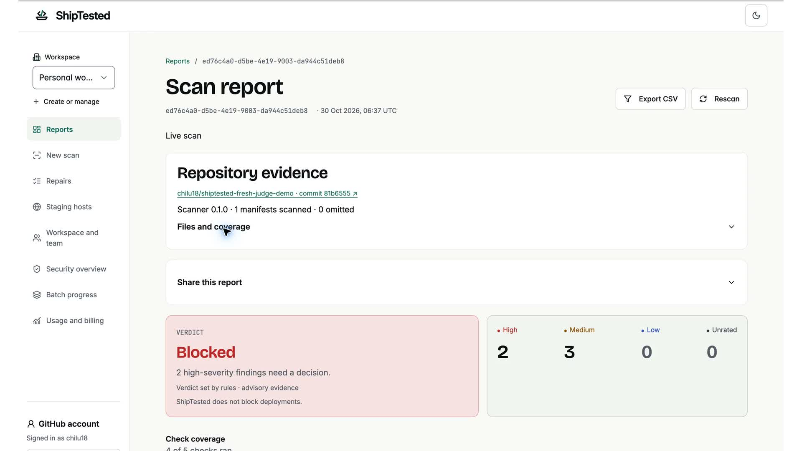

# See ShipTested in action

[](https://youtu.be/JDITvuA2lD8)

**[Watch on YouTube · 2:45](https://youtu.be/JDITvuA2lD8)** · [Read the transcript](media/demo-transcript.txt) · [Back to the README](../README.md)

## Choose a test path

| What you want to evaluate | How to do it | What it proves |
| --- | --- | --- |
| The complete hosted journey | Watch the video and inspect the public draft PR below. | A recorded repository scan, a separate live Nemotron manifest scan, sandbox verification and approved publication. |
| The report UI, without accounts or keys | Follow the [quickstart](../README.md#run-it-locally), then select **Run the demo**. | Local rendering of stored evidence. This does not make a fresh provider call. |
| A fresh dependency scan | Build the workspaces, then run the CLI command below. | A new OSV lookup using exact dependency versions. No AI, database or repair account is needed. |
| Your own end-to-end repair | Configure [member access, a selected-repository GitHub App and sandbox execution](LOCAL-DEVELOPMENT.md), using a disposable repository you control. | A new run, with your own permissions, test results and publication approval. Setup is required. |

```sh
# From the repository root, after npm ci and npm run build:packages:
node packages/cli/dist/index.js scan docs/demo-input/package-lock.json --json
```

The fixture contains an intentionally old lodash pin. Treat it as scan input; do not run `npm install` inside a vulnerable fixture. OSV data changes, so a fresh scan may return different counts from the recording. A nonzero CLI exit code is expected when findings or incomplete checks are present; see the [exit-code reference](../packages/cli/README.md).

## Video chapters

| Time | What to look for |
| --- | --- |
| [0:00](https://www.youtube.com/watch?v=JDITvuA2lD8&t=0s) | Enter the fresh public demo repository URL. |
| [0:16](https://www.youtube.com/watch?v=JDITvuA2lD8&t=16s) | Scan progress, the pinned source commit and the saved report. |
| [0:35](https://www.youtube.com/watch?v=JDITvuA2lD8&t=35s) | Open a finding and inspect its advisory evidence. |
| [0:48](https://www.youtube.com/watch?v=JDITvuA2lD8&t=48s) | Submit the same repository's lockfile with AI triage enabled. |
| [1:01](https://www.youtube.com/watch?v=JDITvuA2lD8&t=61s) | Inspect Nemotron's model identity, validated selections and selected note. |
| [1:24](https://www.youtube.com/watch?v=JDITvuA2lD8&t=84s) | Return to the repository workflow and prepare a repair. |
| [1:36](https://www.youtube.com/watch?v=JDITvuA2lD8&t=96s) | Review the proposed dependency change and start verification. |
| [1:48](https://www.youtube.com/watch?v=JDITvuA2lD8&t=108s) | See sandbox verification complete. |
| [2:01](https://www.youtube.com/watch?v=JDITvuA2lD8&t=121s) | Compare baseline/patched test commands and dependency findings. |
| [2:15](https://www.youtube.com/watch?v=JDITvuA2lD8&t=135s) | Approve the exact patch and open the draft pull request. |
| [2:34](https://www.youtube.com/watch?v=JDITvuA2lD8&t=154s) | Inspect the final GitHub diff. |

## Inspect the recorded evidence

Recorded **30 October 2026**, using an authenticated account and a public synthetic repository. This is an edited screen recording: waits and navigation are shortened. The Nemotron result is reopened for a clearer view after the live request; this is not a second inference call.

- **Repository:** [chilu18/shiptested-fresh-judge-demo](https://github.com/chilu18/shiptested-fresh-judge-demo).
- **Scanned revision:** [`81b6555`](https://github.com/chilu18/shiptested-fresh-judge-demo/tree/81b655510ad60a693dcb8f1c745f9a7d5dd8bda5).
- **Dependency change:** `lodash 4.17.20 → 4.18.1`.
- **Sandbox evidence:** baseline and patched tests exited 0; dependency advisories fell from 5 to 0; cleanup completed.
- **AI evidence:** `nvidia/nemotron-3-super-120b-a12b` on Nebius Token Factory; 5 validated scanner-note selections; 0 fallbacks.
- **Publication:** [draft PR #1](https://github.com/chilu18/shiptested-fresh-judge-demo/pull/1), changing only `package.json` and `package-lock.json`. Left unmerged at recording time.



The AI segment is a **separate manifest scan**, not proof that the repository scan worker itself called Nemotron. The model selects approved scanner notes; it does not generate the repair patch or decide that a release is secure. Tavily research was not configured in this run, and staging-host checks were outside its scope.

## Reproduce a repair on your own repository

The hosted recording includes application changes and service configuration newer than this repository's recorded-demo baseline. Do not expect a fresh checkout, or anonymous access to the hosted site, to reproduce the entire video automatically. The local setup guide describes the supported source workflow and required services.

Once your configured environment is ready:

1. Sign in as an admitted member. GitHub identity sign-in alone does not grant repository access.
2. Connect the GitHub App to a disposable repository you control, with a committed npm lockfile and meaningful tests. Keep repository selection narrow.
3. Run a supported dependency scan and inspect findings, sources, source revision and omitted checks. Use the manifest workflow if your source checkout has no hosted URL-scan worker.
4. Optionally enable Nemotron for the manifest scan and inspect whether notes were validated or fell back. An incomplete provider check is not a pass.
5. Select the repository in **Repairs** and prepare a supported direct npm dependency upgrade. Review the patch before running it.
6. Run the explicitly enabled sandbox verification. Inspect both test phases, the generated lockfile, dependency rescan and cleanup status. A missing or failing check is not successful verification.
7. Approve only after reviewing the exact change and its evidence. Publication creates a new branch and draft PR; it does not merge or deploy the fix.

Repair support is deliberately limited. Unsupported inputs, unavailable fixes, failing tests, missing installation grants or exhausted run allowances can stop the workflow. The demo's successful dependency rescan does not establish whole-application security or runtime exploitability.
