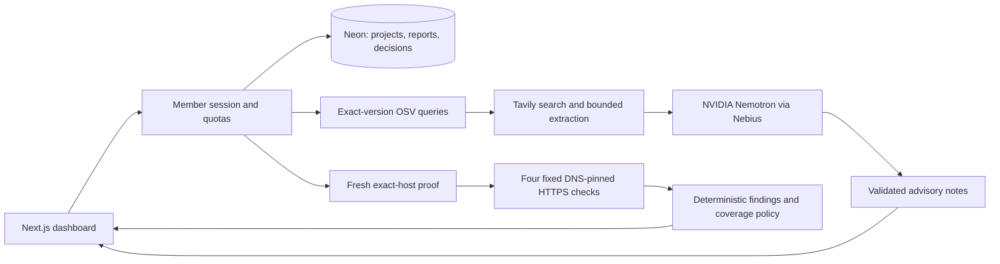

# ShipTested — submission material for team review

Status: team-review draft, refreshed 27 October 2026. The public website and separate MCP/docs/developer services are deployed with Peter’s approval. This document is not evidence of video publication or final hackathon submission.

## One sentence

ShipTested helps small teams review dependency and staging-site risks before release, with traceable evidence, explicit coverage gaps and human decisions.

## Implemented story

A member signs in with an individual key, creates a project and proves control of its exact staging hostname. ShipTested checks exact dependency versions with OSV and performs four bounded passive HTTPS requests against a freshly verified host. Tavily supplies limited search and advisory extraction; NVIDIA Nemotron on Nebius explains existing findings without controlling their severity or verdict. Reports and review decisions persist with member isolation.

The offline demo uses real deterministic rules on synthetic input and a dated OSV snapshot. Live-provider failures remain visibly incomplete; no fixture silently replaces a live result. Search/watch items never become vulnerabilities merely because an LLM repeats them.

## Architecture

## Under-three-minute recording script

- 0:00–0:20: “Small teams need evidence before release. ShipTested shows what it checked, what it found and what it could not verify.” Show the protected dashboard.
- 0:20–0:45: Run the offline demo. Show the synthetic credential pattern, dated dependency advisory and explicit incomplete coverage. State that this is synthetic input, not a real breach.
- 0:45–1:15: Sign in before recording sensitive entry. Show project setup, the exact hostname and successful file proof on the synthetic staging target. Never show access keys, environment files or provider dashboards with credentials.
- 1:15–1:55: Open the saved live acceptance report. Point to dependency evidence, four passive checks, original source retrieval dates, and the difference between scanner-matched advisories and unconfirmed watch items. State that current host findings are configuration reviews, not verified exploits.
- 1:55–2:20: Show a Nemotron note and the deterministic verdict. “The model explains evidence; it cannot remove findings or approve the release.”
- 2:20–2:45: Acknowledge a finding with a reason and reopen the saved report. Show that the original verdict remains unchanged.
- 2:45–2:55: State limitations: no source execution, no exploitation, no patch application, no guarantee of security. Show repository licence and architecture.

## Current deliverables and scope

- Public recorded demo: https://shiptested.com — synthetic recorded evidence; public live scan/repair APIs remain disabled.
- Public read-only MCP: https://mcp.shiptested.com/mcp — three deterministic tools, no provider credentials, no repository execution.
- Documentation: https://docs.shiptested.com/docs
- Developer playground: https://dev.shiptested.com — real OSV scan and stage notifications.
- Core library, CLI and local MCP: 0.1.0 published; registry integrity, clean installation, CLI scan, library import and local MCP verified.
- Claude Code with GLM through Cloudflare exercised the hosted MCP successfully. Guides for other clients are configuration guidance, not verified marketplace listings.
- Separate repair development evidence covers one explicitly selected fixture: GitHub sign-in, baseline/patched Vercel Sandboxes and a human-approved draft PR. This does not claim that public visitors can repair arbitrary repositories. The repair planner uses deterministic OSV evidence; it does not currently call Nemotron or Tavily.

## Sponsor implementation and feedback draft

NVIDIA Nemotron through Nebius Token Factory selects a supplied scanner note verbatim. Schema and exact-note validation prevent it from inventing impacts, lowering severity or changing the verdict. Tavily Search/Extract supplies bounded contextual sources, with exact package association and dates. Research remains unconfirmed unless tied to scanner evidence. The public deterministic MCP does not invoke these paid providers; demonstrate the separately recorded live-provider application run when describing their use.

Engineering feedback: structured model output still needs strict application validation; exact source association matters more than fluent prose; provider failure needs an explicit coverage state. These are observed implementation lessons, not vendor performance benchmarks. Louise and Peter should review wording before submitting official feedback.

## Final submission checklist

- Louise: review narrative, architecture, limitations and sponsor feedback; select the official best-fit track with Peter.
- Peter: verify final release URLs, source licence/setup, package availability and clean-browser demo access.
- Both: approve the existing 67-second narrated live-provider video or revise it to reflect the platform extension. It is edited real browser footage, not a continuous recording.
- Publish the approved video publicly in the required format and record its public URL. Private Drive review access is not publication.
- Verify current official rules/deadline and required fields, then obtain final team approval before submission.

The website, CLI and hosted MCP are separate demonstration surfaces. Do not imply that a recorded website animation represents a live scan, or that the deterministic MCP itself uses Nemotron.

## Claims to avoid

Do not claim full pentesting, zero false negatives, automatic remediation, verified exploitability, full repository scanning, or guaranteed compliance/security. Do not call unit-test pass counts a detection-accuracy benchmark. Do not claim the £15 database budget is a hard billing cap.
