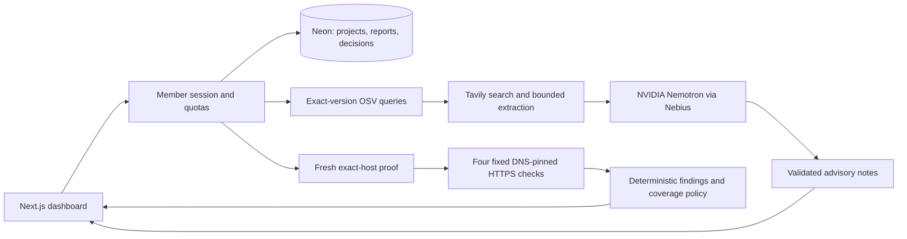

# ShipCheck — submission material for team review

Status: draft only. Peter requested a protected team preview. No public launch, video upload or hackathon submission is authorized by this document.

## One sentence

ShipCheck helps small teams review dependency and staging-site risks before release, with traceable evidence, explicit coverage gaps and human decisions.

## Implemented story

A member signs in with an individual key, creates a project and proves control of its exact staging hostname. ShipCheck checks exact dependency versions with OSV and performs four bounded passive HTTPS requests against a freshly verified host. Tavily supplies limited search and advisory extraction; NVIDIA Nemotron on Nebius explains existing findings without controlling their severity or verdict. Reports and review decisions persist with member isolation.

The offline demo uses real deterministic rules on synthetic input and a dated OSV snapshot. Live-provider failures remain visibly incomplete; no fixture silently replaces a live result. Search/watch items never become vulnerabilities merely because an LLM repeats them.

## Architecture

## Under-three-minute recording script

- 0:00–0:20: “Small teams need evidence before release. ShipCheck shows what it checked, what it found and what it could not verify.” Show the protected dashboard.
- 0:20–0:45: Run the offline demo. Show the synthetic credential pattern, dated dependency advisory and explicit incomplete coverage. State that this is synthetic input, not a real breach.
- 0:45–1:15: Sign in before recording sensitive entry. Show project setup, the exact hostname and successful file proof on the synthetic staging target. Never show access keys, environment files or provider dashboards with credentials.
- 1:15–1:55: Open the saved live acceptance report. Point to dependency evidence, four passive checks, original source retrieval dates, and the difference between scanner-matched advisories and unconfirmed watch items. State that current host findings are configuration reviews, not verified exploits.
- 1:55–2:20: Show a Nemotron note and the deterministic verdict. “The model explains evidence; it cannot remove findings or approve the release.”
- 2:20–2:45: Acknowledge a finding with a reason and reopen the saved report. Show that the original verdict remains unchanged.
- 2:45–2:55: State limitations: no source execution, no exploitation, no patch application, no guarantee of security. Show repository licence and architecture.

## Remaining human release items

- Louise independently reviews product flow and signs in with her privately delivered member key.
- Team chooses track and verifies official rules/deadline directly before submission.
- Peter decides when to enable public judging access; protected previews are not a public submission URL.
- Record, review and upload the video; complete required sponsor feedback and submit only after final human review.

## Claims to avoid

Do not claim full pentesting, zero false negatives, automatic remediation, verified exploitability, full repository scanning, or guaranteed compliance/security. Do not call unit-test pass counts a detection-accuracy benchmark. Do not claim the £15 database budget is a hard billing cap.
