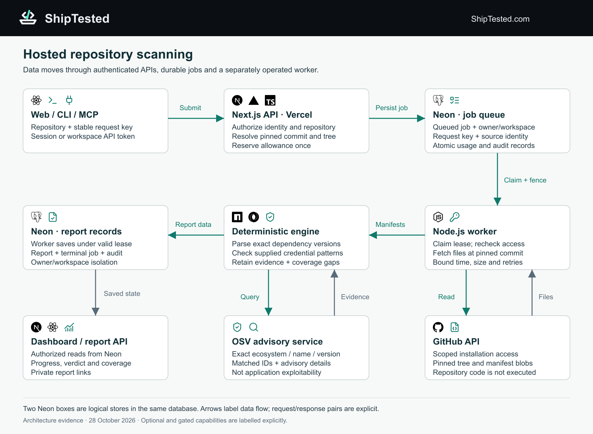
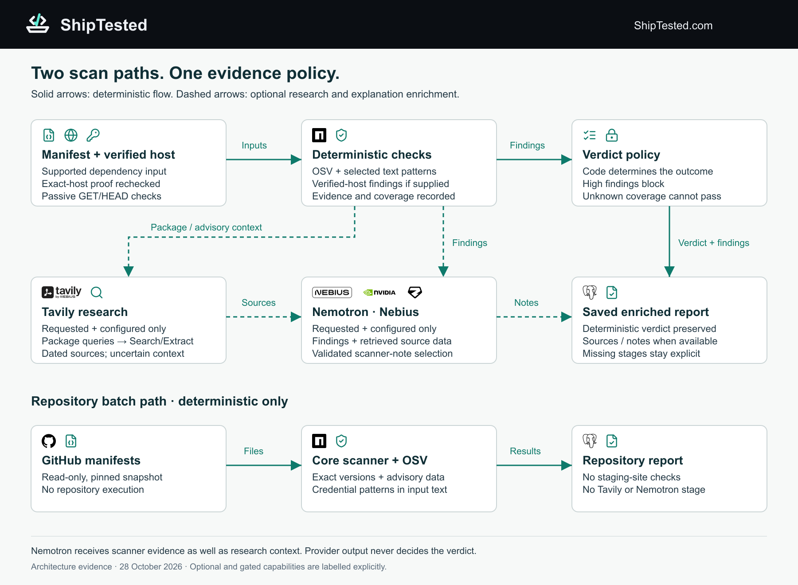
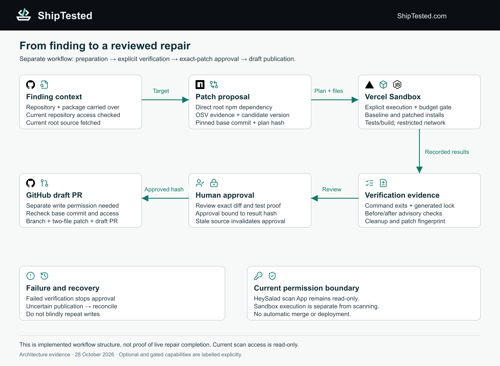

# ShipTested infrastructure diagrams

Three original diagrams from the architecture addendum in [ShipCheck Project Plan V0.2](https://docs.google.com/document/d/1qO_AWsA8Tkk8zwh3qgpDqoLhq17SO9D62aVLJDT3WkA/edit). The Google Doc may require access. These local assets do not require access to the document.

**For Devpost: upload the three files in [`png/`](png).** Each is 1800 × 1320 pixels. Editable, self-contained vector versions are in [`svg/`](svg), and ready-to-copy descriptions are in [DEVPOST-CAPTIONS.md](DEVPOST-CAPTIONS.md).

These are the original **28 October 2026** architecture figures, retrieved on 30 October. All three PNGs are byte-for-byte identical to the images embedded in the Google Doc. Their wording has been preserved. The repair figure's permission/status notes describe the earlier architecture checkpoint; the [30 October recorded demo](../RECORDED-DEMO.md) separately demonstrates a successful repair and approved draft PR using the demo's authorized GitHub App. Architecture diagrams are not execution evidence.

## 1. Hosted repository scanning

The authenticated API, durable job queue, separate Node.js worker, GitHub reads, deterministic scanner, OSV lookup and saved reports. The two Neon boxes represent logical stores in the same database.

[PNG](png/01-hosted-repository-scanning.png) · [SVG](svg/01-hosted-repository-scanning.svg)

## 2. Enriched scan and repository batch

The manifest workflow can request Tavily research and NVIDIA Nemotron on Nebius. The separate repository batch path performs deterministic dependency scanning without those enrichment stages. Optional providers do not determine the verdict.

[PNG](png/02-enriched-scan-and-repository-batch.png) · [SVG](svg/02-enriched-scan-and-repository-batch.svg)

## 3. Repair verification and approval

A supported patch proposal goes through Vercel Sandbox verification, recorded evidence and exact-patch human approval before draft PR publication. Failure and uncertain publication have explicit recovery paths. No automatic merge or deployment.

**Historical label:** this original figure says the HeySalad scan App is read-only and does not itself establish live repair completion. The later [demo draft PR](https://github.com/chilu18/shiptested-fresh-judge-demo/pull/1) was created through the separately authorized repair App. Include the dated caption when using the original figure.

[PNG](png/03-repair-verification-and-approval.png) · [SVG](svg/03-repair-verification-and-approval.svg)

## Original MVP figure

The earlier ShipCheck-branded MVP architecture is retained separately in [`archive/00-original-shipcheck-mvp.png`](archive/00-original-shipcheck-mvp.png), at 2000 × 1120 pixels. It is historical planning material, not the recommended lead image for the current submission.

## Provenance and attribution

[provenance.json](provenance.json) records the source document, export date, figure mapping, dimensions and SHA-256 hashes. The public folder contains only the diagrams, captions and provenance; it does not contain the full project-plan export or temporary download links.

Technology marks identify components or formats, not endorsement. GitHub, Next.js, Vercel, React, TypeScript, Node.js, PostgreSQL, npm, JSON and Zod marks came from Simple Icons v16; Tavily, Nebius and NVIDIA marks reused existing project partner assets. Lucide icons identify workflow concepts. Third-party marks retain their applicable rights and licences.
